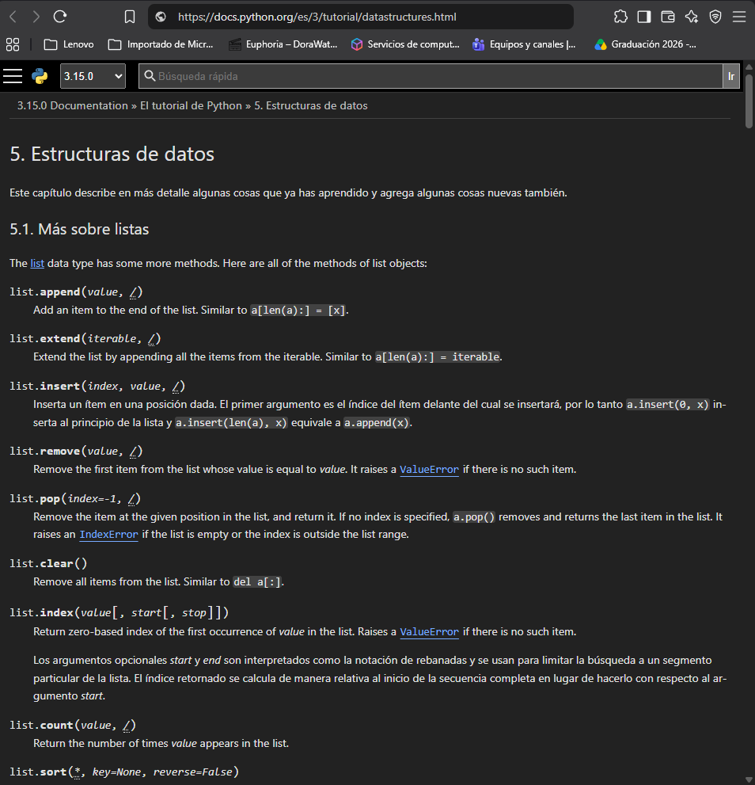

# Práctica 4: Exploración de comunidades, documentación y recursos de colaboración

## 1. Propósito de la práctica
Conocer y evaluar recursos técnicos de documentación oficial, herramientas de redes y comunidades de colaboración para establecer una base de conocimiento sólida orientada a la resolución de problemas en el proyecto integrador.

## 2. Relación con el proyecto integrador
Permite que el equipo adquiera habilidades de investigación estructurada, evaluación de fuentes confiables y resolución de incidencias en scripts de Python y topologías de GNS3.

## 3. Recursos consultados: síntesis y enlaces
* **Documentación de Python:** [https://www.python.org/](https://www.python.org/) / [https://docs.python.org/es/3/](https://docs.python.org/es/3/)
* **Documentación y recursos de redes:** [Cisco DevNet](https://developer.cisco.com/docs/), [Network to Code](https://networktocode.com/community/open-source/), [Red Hat Ansible](https://www.redhat.com/es/technologies/management/ansible/network-automation).
* **Comunidades:** [Stack Overflow en español](https://es.stackoverflow.com/) y [Comunidad de Python](https://www.python.org/community/).

## 4. Evaluación de confiabilidad: tabla comparativa

| Criterio | Recurso 1: Python | Recurso 2: GNS3 | Recurso 3: Stack Overflow |
| :--- | :--- | :--- | :--- |
| **¿Quién publica o mantiene el recurso?** | Proyecto Python / Python Software Foundation | Proyecto GNS3 | Stack Overflow y su comunidad |
| **¿La información corresponde al tema investigado?** | Sí, programación en Python | Sí, simulación de redes | Sí, solución de problemas de programación |
| **¿Incluye ejemplos o instrucciones verificables?** | Sí, tutoriales y ejemplos | Sí, guías de configuración | Sí, ejemplos y respuestas de usuarios |
| **¿Se identifica la versión o fecha de actualización?** | Sí, versión de Python | Depende de la página consultada | Depende de la publicación |
| **¿Es posible comprobar la información con otra fuente?** | Sí, mediante pruebas y otras referencias | Sí, mediante pruebas en GNS3 | Sí, con documentación oficial |
| **¿Qué utilidad tiene para el proyecto integrador?** | Desarrollar programas en Python | Configurar topologías de red | Investigar y resolver errores |

## 5. Estrategia de solución del problema (Situación hipotética)

* **Problema identificado:** El programa muestra los dispositivos R1 y R2, pero no encuentra un dispositivo al buscarlo por su nombre.
* **Palabras clave:** `Python buscar diccionario por nombre`, `Python buscar elemento en lista`, `error búsqueda Python`.
* **Documentación o comunidad consultada primero:** Documentación oficial de Python y Stack Overflow en español.
* **Información a revisar en el código:** Nombres de dispositivos, estructura de datos, condiciones `if`, ciclos y función de búsqueda.
* **Tipo de ejemplo o solución buscada:** Ejemplos de búsqueda de elementos en listas y diccionarios.
* **Cómo comprobarían que la solución funciona:** Probar búsquedas de R1, R2 y un dispositivo inexistente, verificando los resultados.
* **Cómo documentarían la solución encontrada:** Registrar el problema, la solución, las pruebas y las fuentes en el README de GitHub.

## 6. Evidencia de Estructuras de Datos (Python)
- **Consulta de listas y métodos:**
  

## . Aprendizajes obtenidos
Se comprendió la importancia de contrastar información de foros con la documentación oficial, así como la necesidad de estructurar búsquedas y verificar la compatibilidad de herramientas de automatización.

## 7. Conclusiones individuales

### Christian Noe Esparza Meza
Durante esta práctica aprendí la importancia de consultar documentación oficial y comunidades de programación. Comprendí que la documentación oficial ofrece información confiable, mientras que las comunidades comparten experiencias y soluciones de otros usuarios. Para saber si una fuente es confiable, es importante revisar quién la publica, cuándo fue actualizada y si contiene información correcta. Las comunidades pueden ayudarme a resolver errores de Python mediante ejemplos y respuestas de otros programadores. También aprendí que GitHub permite guardar y organizar las soluciones encontradas. Esto facilita que los integrantes del equipo puedan consultar la información cuando la necesiten. Además, estos recursos nos ayudarán a solucionar problemas relacionados con GNS3 y la automatización de redes. Considero que lo aprendido será de gran utilidad para desarrollar las siguientes prácticas del proyecto integrador.

### Samuel Ceniceros Dorantes
Con esta actividad comprendí que existen diferentes recursos que pueden ayudarnos durante el desarrollo de un proyecto. La documentación oficial proporciona instrucciones y explicaciones sobre las herramientas, mientras que las comunidades ofrecen respuestas a problemas específicos. Para elegir una fuente confiable debemos verificar que tenga información actualizada, ejemplos claros y un autor reconocido. En Python, las comunidades pueden ser útiles cuando encontramos errores que no sabemos cómo solucionar. Podemos buscar preguntas similares y revisar las soluciones que otros usuarios han compartido. También es importante documentar en GitHub los problemas encontrados y los pasos que seguimos para resolverlos. De esta manera evitamos repetir errores y mantenemos un registro del trabajo realizado. Estos conocimientos nos permitirán trabajar de manera más organizada y mejorar nuestros programas de automatización de redes.

### Cesar Alexander Fuentes García
Al realizar esta investigación conocí herramientas y comunidades que facilitan el aprendizaje de Python y la configuración de redes. Aprendí que la documentación oficial contiene información técnica de las herramientas, mientras que las comunidades permiten intercambiar conocimientos. Considero importante comprobar que las fuentes sean confiables, estén actualizadas y tengan ejemplos que podamos verificar. Cuando tenga dificultades con un programa de Python, podré consultar Stack Overflow o la documentación oficial para encontrar posibles soluciones. Sin embargo, antes de utilizar cualquier código será necesario comprobar que funcione correctamente en nuestro proyecto. GitHub nos ayudará a almacenar los archivos y registrar las soluciones para que todo el equipo tenga acceso a ellas. También podremos utilizar Cisco DevNet, GNS3 y otros recursos para investigar problemas de configuración y automatización. En conclusión, esta práctica me enseñó que investigar, comprobar y documentar la información es fundamental para desarrollar correctamente el proyecto integrador.