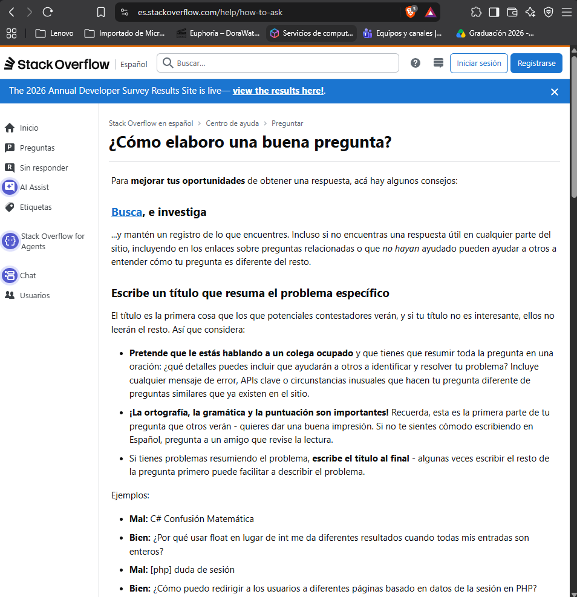

# Comunidades de Colaboración

## Tabla de Comunidades

| Recurso o comunidad | Tipo de recurso | ¿Qué tipo de problemas ayuda a resolver? | ¿Cómo podría utilizarlo el equipo? |
| :--- | :--- | :--- | :--- |
| **Stack Overflow en español** | Comunidad de preguntas y respuestas | Errores de programación y dudas sobre código | Buscar soluciones a errores de Python |
| **GitHub** | Plataforma de desarrollo colaborativo | Errores de proyectos, organización y cambios de código | Compartir archivos, registrar cambios y colaborar |
| **Comunidad de GNS3** | Comunidad de usuarios de redes | Problemas de instalación, simulación y configuración | Investigar errores de las topologías y encontrar recomendaciones |

---

## Preguntas de análisis

1. **¿Qué ventajas ofrece una comunidad de colaboración frente a buscar información sin un objetivo definido?**
Las comunidades de colaboración permiten encontrar soluciones a problemas específicos, consultar experiencias de otros usuarios y recibir orientación técnica, haciendo más rápida y organizada la búsqueda de información.

2. **¿Por qué conviene revisar si una pregunta similar ya fue respondida?**
Porque permite ahorrar tiempo, evitar preguntas duplicadas y aprovechar soluciones que otras personas ya encontraron y explicaron.

3. **¿Qué información debería incluir una pregunta técnica para facilitar que otras personas comprendan el problema?**
Debe incluir un título claro, descripción del problema, código relacionado, mensajes de error, resultado esperado y lo que se ha intentado para solucionarlo.

4. **¿Por qué es importante describir lo que ya se intentó y los errores encontrados?**
Porque ayuda a comprender mejor el problema, evita repetir soluciones que ya fallaron y facilita que otras personas identifiquen la causa del error.

5. **¿Qué comportamiento debe mantener un estudiante al solicitar ayuda o utilizar una solución publicada por otra persona?**
Debe mantener una actitud respetuosa, investigar antes de preguntar, explicar claramente sus dudas, agradecer la ayuda y comprobar las soluciones antes de utilizarlas.

- **Stack Overflow (Cómo hacer una buena pregunta):**
  

- **Comunidad de Python:**
  
  