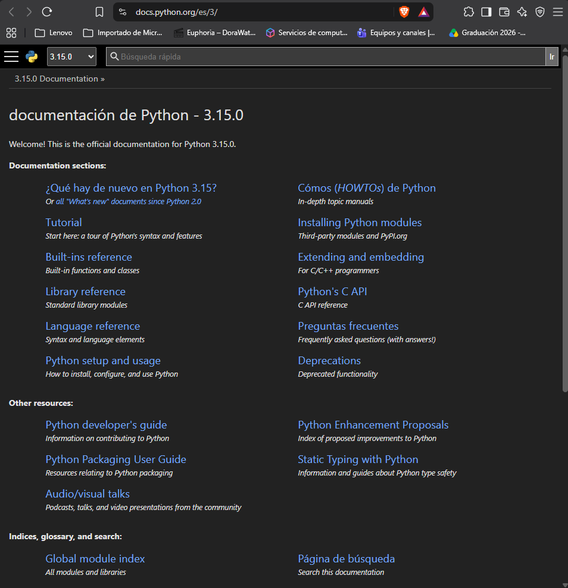
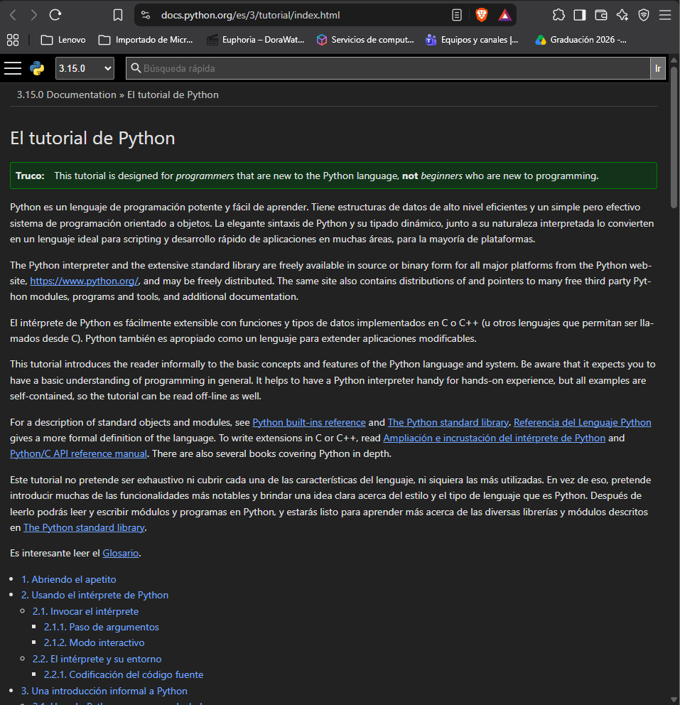
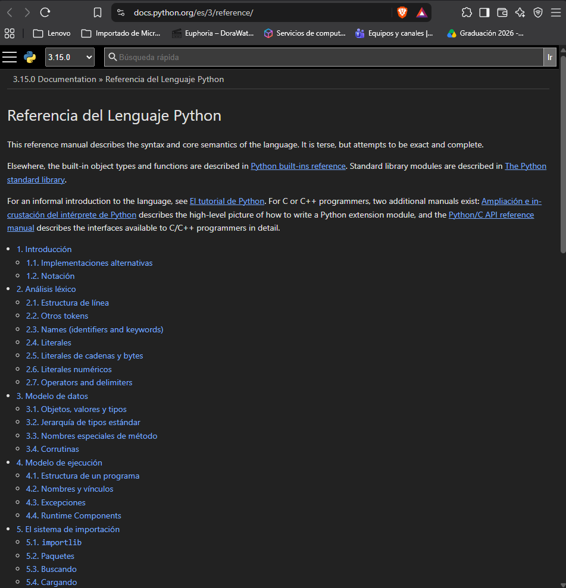

#parte 2 recursos de python 
# Recursos de Python

## Preguntas de investigación sobre Python

1. **¿Qué es la documentación oficial de un lenguaje de programación?**
Es el conjunto de manuales, guías y referencias publicados por los responsables de un lenguaje de programación. Explica su sintaxis, funcionamiento, características y herramientas.

2. **¿Qué información puede encontrarse en ella?**
Se puede encontrar información sobre variables, tipos de datos, estructuras de control, funciones, módulos, bibliotecas, instalación del lenguaje y ejemplos de programación.

3. **¿Cómo puede ayudar a resolver dudas sobre variables, listas, diccionarios, ciclos y funciones?**
Permite consultar ejemplos de código y explicaciones sobre cómo declarar variables, utilizar listas y diccionarios, realizar ciclos y crear funciones. Esto ayuda a comprender su funcionamiento y corregir errores.

4. **¿Qué diferencia existe entre consultar documentación oficial y utilizar una respuesta publicada en un foro?**
La documentación oficial presenta información desarrollada y mantenida como referencia del lenguaje, mientras que las respuestas de los foros son aportaciones de usuarios que comparten soluciones a problemas específicos. Estas últimas deben comprobarse antes de utilizarlas.

---

## Recursos seleccionados de Python

| Campo | Recurso 1 | Recurso 2 |
| :--- | :--- | :--- |
| **Nombre** | Tutorial de Python | Biblioteca estándar de Python |
| **URL** | [https://docs.python.org/es/3/tutorial/index.html](https://docs.python.org/es/3/tutorial/index.html) | [https://docs.python.org/es/3/](https://docs.python.org/es/3/) |
| **Tema** | Fundamentos y sintaxis de Python | Módulos y funciones disponibles |
| **Información** | Explicaciones y ejemplos de código | Referencias, funciones y módulos |
| **Utilidad para el proyecto** | Ayuda a desarrollar `dispositivos.py` | Facilita el procesamiento de información |
| **Ejemplo de consulta** | Buscar cómo recorrer diccionarios | Consultar un módulo para trabajar con datos |
## 3. Evidencias de la Documentación de Python

- **Documentación Principal:**
  

- **Tutorial Oficial:**
  

- **Referencia del Lenguaje:**
  