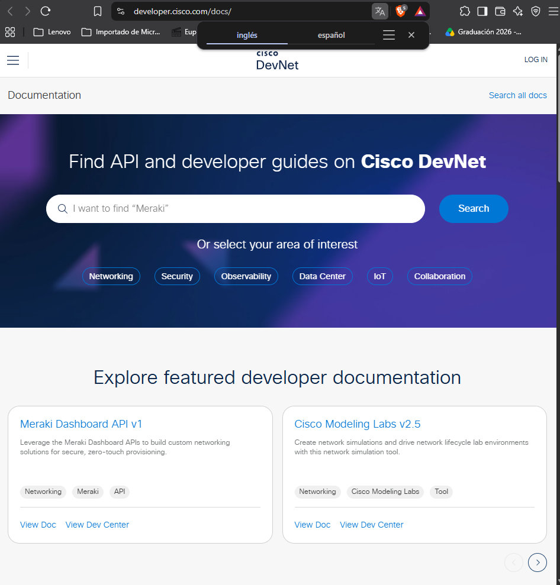
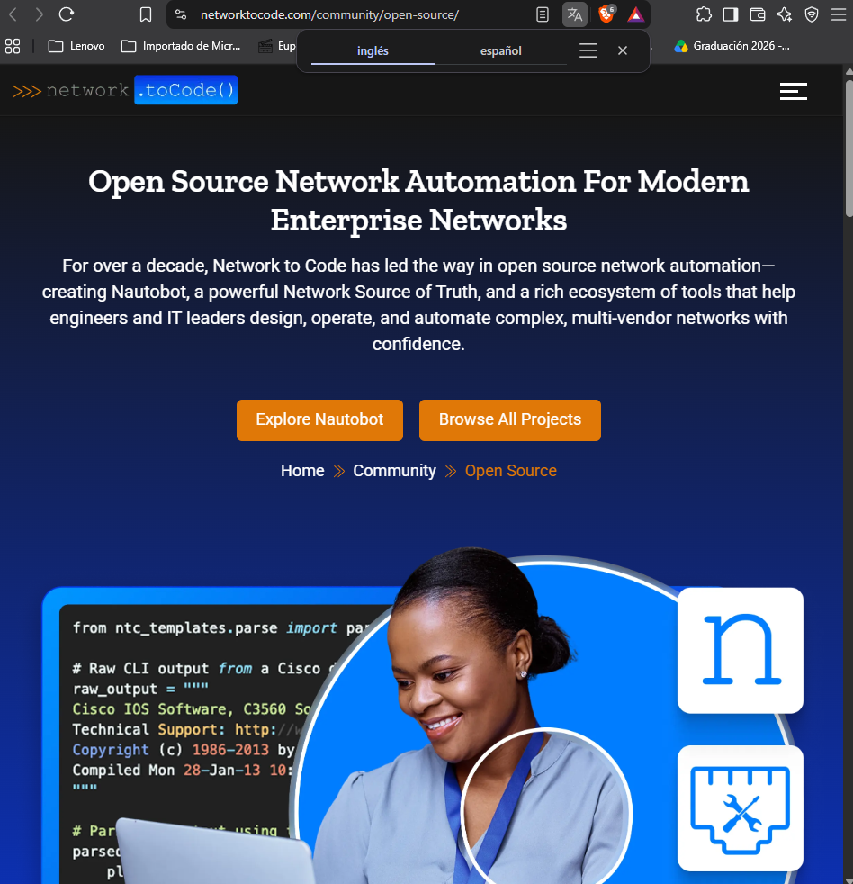
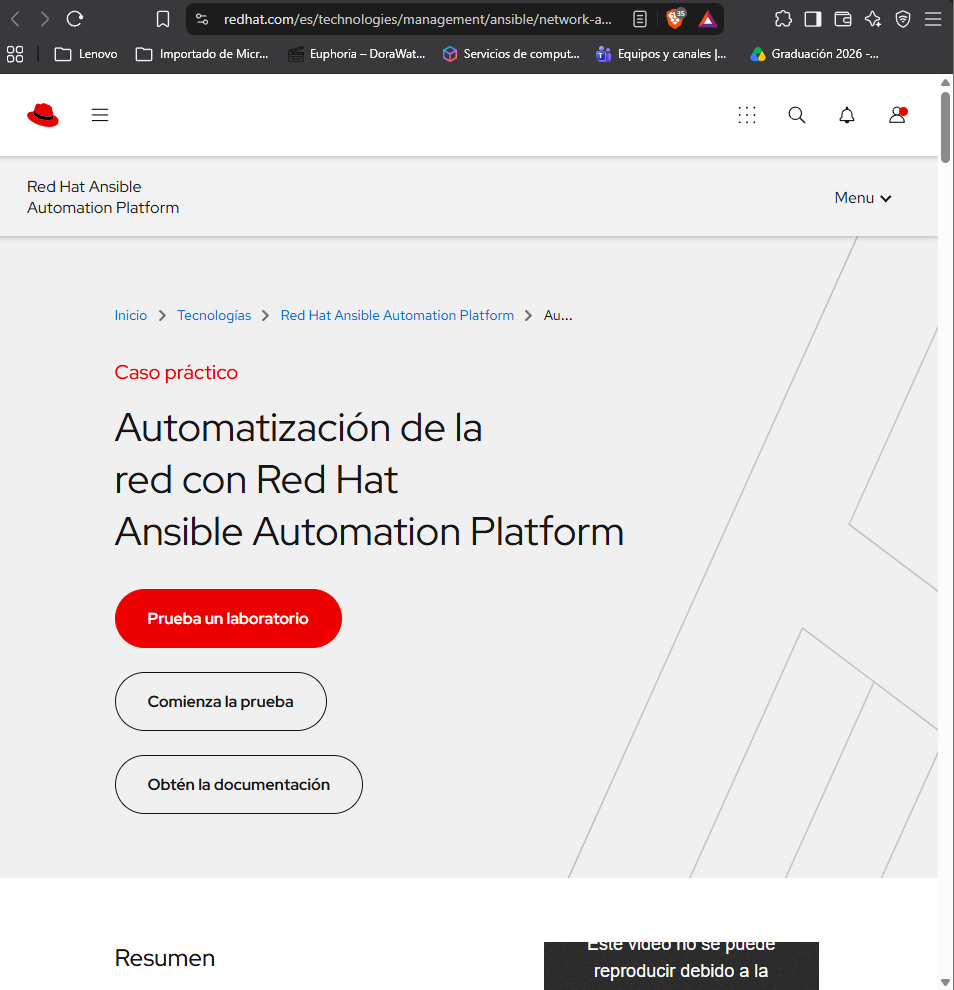

# Recursos de Redes y GNS3

## Preguntas de investigación sobre GNS3 y Automatización

1. **¿Qué tipo de problema podrías resolver consultando la documentación de GNS3?**
La documentación de GNS3 permite resolver problemas relacionados con la instalación, configuración de máquinas virtuales, creación de topologías, conexión de dispositivos y funcionamiento de redes simuladas.

2. **¿Qué diferencia existe entre la documentación de una herramienta y el repositorio de una biblioteca?**
La documentación de una herramienta explica su instalación, configuración y funcionamiento. En cambio, el repositorio de una biblioteca contiene código fuente, instrucciones de instalación, ejemplos, versiones y herramientas para colaborar en su desarrollo.

3. **¿Qué información revisarías antes de utilizar una biblioteca de automatización?**
Revisaría los requisitos de instalación, las dependencias, las versiones compatibles, los dispositivos admitidos, las funciones disponibles, los ejemplos de uso y los errores conocidos.

4. **¿Por qué es importante comprobar qué plataformas y funciones admite una biblioteca?**
Porque no todas las bibliotecas funcionan con los mismos equipos, sistemas operativos o protocolos. Verificar su compatibilidad ayuda a evitar errores de conexión y permite seleccionar la herramienta adecuada.

5. **¿Cómo podrían utilizarse estos recursos en las siguientes prácticas?**
Estos recursos podrían utilizarse para crear topologías en GNS3, investigar errores de configuración, desarrollar programas de automatización con Python y administrar dispositivos de red mediante bibliotecas compatibles.

---

## Recursos técnicos de redes y automatización

| Campo | Recurso 1 | Recurso 2 | Recurso 3 |
| :--- | :--- | :--- | :--- |
| **Nombre** | Cisco DevNet | Network to Code | Red Hat Ansible Automation Platform |
| **URL** | [https://developer.cisco.com/docs/](https://developer.cisco.com/docs/) | [https://networktocode.com/community/open-source/](https://networktocode.com/community/open-source/) | [https://www.redhat.com/es/technologies/management/ansible/network-automation](https://www.redhat.com/es/technologies/management/ansible/network-automation) |
| **Tema** | APIs y programación de redes Cisco | Automatización de redes y código abierto | Automatización de redes y TI |
| **Información** | Documentación técnica y ejemplos de APIs | Herramientas, proyectos y recursos técnicos | Funciones, casos prácticos y herramientas |
| **Utilidad para el proyecto** | Conocer la administración programable de dispositivos | Investigar bibliotecas para redes | Comprender tareas de automatización |
| **Ejemplo de consulta** | Consultar una API de Cisco | Investigar herramientas de automatización | Automatizar configuraciones de routers |

## 3. Evidencias de Recursos de Redes

- **Cisco DevNet:**
  

- **Network to Code:**
  

- **Red Hat Ansible:**
  